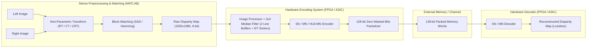

# Spatial Correlations Based Disparity Map Compression — MATLAB Models & Low-Cost Hardware Architectures

This repository contains the complete RTL hardware designs (Verilog), MATLAB algorithmic models, hardware-software co-verification scripts, FPGA/ASIC constraints, and automated tool scripts accompanying our paper published in ***Integration, the VLSI Journal*** (2023):

> **Mustafa Ghanim, Ozgur Tasdizen, H. Fatih Ugurdag, and Ilker Hamzaoglu**, *"An efficient algorithm for disparity map compression based on spatial correlations and its low-cost hardware architecture"*, **Integration**, vol. 93, p. 102069, 2023.  
> 🔗 DOI: [`https://doi.org/10.1016/j.vlsi.2023.102069`](https://doi.org/10.1016/j.vlsi.2023.102069)

If you use these implementations, scripts, or benchmarks in your research, please [cite our paper](#6-citation).

---

## Table of Contents

1. [Overview & Key Contributions](#1-overview--key-contributions)
2. [Repository Directory Structure](#2-repository-directory-structure)
3. [Algorithms & Hardware Architectures](#3-algorithms--hardware-architectures)
4. [Reproducing the Study — Step-by-Step Guide](#4-reproducing-the-study--step-by-step-guide)
   - [4.1 MATLAB Stereo Preprocessing, Block Matching & Compression Analysis](#41-matlab-stereo-preprocessing-block-matching--compression-analysis)
   - [4.2 Hardware-Software Co-Verification & RTL Simulation](#42-hardware-software-co-verification--rtl-simulation)
   - [4.3 28 nm Xilinx Spartan-7 FPGA Synthesis, Implementation & SAIF Power (Vivado)](#43-28-nm-xilinx-spartan-7-fpga-synthesis-implementation--saif-power-vivado)
   - [4.4 45 nm Spartan-6 & 90 nm Virtex-4 FPGA Synthesis (Xilinx ISE 14.7)](#44-45-nm-spartan-6--90-nm-virtex-4-fpga-synthesis-xilinx-ise-147)
   - [4.5 40 nm TSMC CMOS ASIC Synthesis (Synopsys Design Compiler)](#45-40-nm-tsmc-cmos-asic-synthesis-synopsys-design-compiler)
5. [Reference Benchmark Results](#5-reference-benchmark-results)
6. [Citation](#6-citation)

---

## 1. Overview & Key Contributions

High-resolution stereo disparity estimation systems (e.g., Full HD $1920 \times 1080$ at $60\text{ fps}$) require high external memory bandwidth to buffer and transmit dense disparity maps. This project exploits the strong spatial correlation (piecewise smoothness) of disparity maps to achieve lossless and near-lossless compression with ultra-low hardware cost:

- **Single Neighbor (SN / Type-1) Compression:** Compares each incoming disparity pixel in raster-scan order against its immediate left neighbor ($x-1, y$). Matching disparities are encoded with a $1$-bit `'1'` flag, while non-matching disparities are encoded with a $1$-bit `'0'` header followed by the $8$-bit disparity value ($9$ bits total). Requires **zero line buffers** ($0\text{ BRAMs}$).
- **Multiple Neighbor (MN / Type-2) Compression:** Compares each disparity pixel against three spatial neighbors—Left ($x-1, y$), Top ($x, y-1$), and Top-Right ($x+1, y-1$)—encoding matches with a $2$-bit header (`01`, `10`, `11`) and uncompressed values with `00` + $8$-bit disparity ($10$ bits total). Implemented using a **single-port RAM** line buffer (1 BRAM) instead of a dual-port RAM.
- **Half Line Buffer (HLB-MN) Compression:** Reduces the MN encoder's line buffer memory by **$50\%$** ($960 \times 8\text{-bit}$ instead of $1920 \times 8\text{-bit}$) by storing only odd-column pixels from the previous row and alternating vertical/diagonal neighbor comparisons between odd and even columns, with $< 0.25\%$ compression ratio loss.
- **Integrated $3 \times 3$ Median Filter (MF) + Encoder Pipeline:** Suppresses block-matching disparity noise prior to encoding, simultaneously improving disparity map PSNR and boosting lossless space savings by $10.5\text{--}11.1\%$. Includes both the standard **7-sorter** network and a column-reuse **5-sorter** optimization that reduces the median filter's combinational area by $28.6\%$.
- **Zero-Wasted-Bits $128$-bit Packetizer & Standalone Decoders:** Packs variable-length codewords into $128$-bit memory words across word boundaries without bit padding waste, paired with standalone hardware decoders (`SN_decoder`, `MN_decoder`).

---

## 2. Repository Directory Structure

```text
Spatial-Correlations-Based-Disparity-Map-Compression/
├── README.md
├── rtl/                                      # Synthesizable Verilog RTL & Testbenches
│   ├── sn_encoder/                           # 1. SN Encoder Only (0 BRAM)
│   │   ├── src/                              #    SN_encodingSystem_top, image_processor, SN_encoder, SN_packetizer
│   │   └── tb/                               #    SN_encoder_only_tb.v
│   ├── mf_sn_encoder/                        # 2. 3x3 Median Filter + SN Encoder
│   │   ├── src/                              #    SN_encoding_system_top, image_processor_with_MF, line_buffer,
│   │   │                                     #    shift_reg, median_filter (5-sorter) & median_filter_7sorter
│   │   └── tb/                               #    SN_MF_encodingSys_tb.v
│   ├── sn_decoder/                           # 3. SN Decoder
│   │   ├── src/                              #    SN_decoder.v
│   │   └── tb/                               #    SN_decoder_tb.v
│   ├── mn_encoder/                           # 4. MN Encoder Only
│   │   ├── src/                              #    Single-Port RAM version (MN_encoding_system_top_v1, MN_encoder_v1, ...)
│   │   ├── src_dual_port/                    #    Dual-Port RAM baseline version for comparison
│   │   └── tb/                               #    MN_encoder_only_tb.v
│   ├── mf_mn_encoder/                        # 5. 3x3 Median Filter + MN Encoder
│   │   ├── src/                              #    Single-Port RAM + 5-sorter (median_filter.v) & 7-sorter MF
│   │   ├── src_dual_port/                    #    Dual-Port RAM baseline version
│   │   └── tb/                               #    MF_MN_Encoder_tb.v
│   ├── hlb_mn_encoder/                       # 6. Half-Line-Buffer (HLB) MN Encoder Only
│   │   ├── src/                              #    HLB_MN_encoding_system_top_v1, HLB_MN_encoder_v1, ...
│   │   └── tb/                               #    HLB_MN_Encoder_tb.v
│   ├── mf_hlb_mn_encoder/                    # 7. 3x3 Median Filter + HLB MN Encoder
│   │   ├── src/                              #    MF_HLB_MN_encoding_system_top, HLB_MN_encoder, HLB, ...
│   │   └── tb/                               #    MF_HLB_MN_Encoder_tb.v
│   └── mn_decoder/                           # 8. MN Decoder
│       ├── src/                              #    MN_decoder.v, MN_decoder_line_buffer.v
│       └── tb/                               #    MN_decoder_tb.v
├── constraints/                              # FPGA Timing Constraint Files (.xdc, .ucf)
│   ├── vivado_spartan7/                      # 28 nm Spartan-7 (xc7s50fgga484-2): 125 MHz & Max Frequency .xdc
│   ├── ise_spartan6_45nm/                    # 45 nm Spartan-6 (xc6slx45-3-fgg484): .ucf constraints
│   └── ise_virtex4_90nm/                     # 90 nm Virtex-4 (xc4vlx15-12-sf363): .ucf constraints
├── data/                                     # Bundled Sample Stereo Images & 1080p Disparity Maps
│   ├── Art/                                  # Stereo image pair & ground-truth disparity map
│   └── *.mat                                 # Full HD (1920x1080) sample disparity maps
├── scripts/                                  # Reproducibility Automation Scripts (Tcl, Bash & Python)
│   ├── vivado/                               # Vivado synthesis, implementation, simulation & SAIF power scripts
│   ├── ise/                                  # Xilinx ISE 14.7 command-line batch scripts (Spartan-6 & Virtex-4)
│   ├── asic/                                 # Synopsys Design Compiler 40nm ASIC synthesis scripts (500 MHz & 1 GHz)
│   └── sim/                                  # Icarus Verilog compilation, 10-path E2E verification & 1080p vector prep
├── matlab/                                   # MATLAB Algorithmic Models, Benchmarks & HW Verification
│   ├── run_all_matlab_verifications.m        # One-command reproducible MATLAB verification & benchmark suite
│   ├── preprocessing_and_block_matching/     # Rank (RT), Census (CT), Complete Rank (CRT), Median Filter, PSNR/RMSE
│   ├── compression_analysis/                 # SN, MN, HLB/QLB-MN, Fixed-Header SN, JPEG-LS, Adaptive Lossy, Quant/RLE
│   └── hardware_verification/                # Hex vector generators, SW reference encoders, 128-bit packet decoders
└── results/                                  # Reference Synthesis, Power & Compression Benchmark Reports
    ├── asic_40nm_reports/                    # Synopsys DC 40nm area/timing/power logs (500 MHz, 1 GHz, NAND2 ref)
    ├── fpga_spartan7_power_reports/          # Vivado post-implementation SAIF power reports
    ├── fpga_ise_screenshots/                 # Reference ISE strategy & FPGA configuration screenshots
    └── summary_tables/                       # Excel summary workbooks for compression, quality, FPGA & ASIC results
```

---

## 3. Algorithms & Hardware Architectures

### 3.1 Complete Stereo Disparity Estimation & Compression Pipeline



### 3.2 Codeword Formats

| Algorithm | Condition | Header Bits | Payload Bits | Total Codeword Length | Encoder Line Buffer |
| :--- | :--- | :---: | :---: | :---: | :---: |
| **SN (Type-1)** | Uncompressed ($d_c \neq d_L$) | `0` ($1\text{ bit}$) | $8\text{ bits}$ | $9\text{ bits}$ | None ($0\text{ bits}$) |
| **SN (Type-1)** | Equal to Left ($d_c = d_L$) | `1` ($1\text{ bit}$) | $0\text{ bits}$ | $1\text{ bit}$ | None ($0\text{ bits}$) |
| **MN (Type-2)** | Uncompressed | `00` ($2\text{ bits}$) | $8\text{ bits}$ | $10\text{ bits}$ | $W \times 8\text{ bits}$ ($1920\text{ B}$) |
| **MN (Type-2)** | Equal to Left ($d_c = d_L$) | `01` ($2\text{ bits}$) | $0\text{ bits}$ | $2\text{ bits}$ | $W \times 8\text{ bits}$ ($1920\text{ B}$) |
| **MN (Type-2)** | Equal to Top ($d_c = d_T$) | `10` ($2\text{ bits}$) | $0\text{ bits}$ | $2\text{ bits}$ | $W \times 8\text{ bits}$ ($1920\text{ B}$) |
| **MN (Type-2)** | Equal to Top-Right ($d_c = d_{TR}$) | `11` ($2\text{ bits}$) | $0\text{ bits}$ | $2\text{ bits}$ | $W \times 8\text{ bits}$ ($1920\text{ B}$) |
| **HLB-MN** | Odd col: $d_L, d_T, d_{TRR}$ / Even col: $d_L, d_{TL}, d_{TR}$ | `00`, `01`, `10`, `11` | $8\text{ or }0\text{ bits}$ | $10\text{ or }2\text{ bits}$ | $(W/2) \times 8\text{ bits}$ ($960\text{ B}$) |

---

## 4. Reproducing the Study — Step-by-Step Guide

### 4.1 MATLAB Stereo Preprocessing, Block Matching & Compression Analysis

All MATLAB scripts are organized under [`matlab/`](matlab/) and use portable cross-platform paths defaulting to the repository's [`data/`](data/) directory (or a custom `DATASET_ROOT` workspace variable if set).

#### One-Command Reproducible MATLAB Verification & Benchmark Suite

In MATLAB, run the master verification script from the repository root:

```matlab
run('matlab/run_all_matlab_verifications.m')
```

This script automatically adds all [`matlab/`](matlab/) subdirectories to the path and executes:
1. **Part 1 — Preprocessing Transforms:** Dynamically discovers stereo image folders in [`data/`](data/) and verifies $7\times 7$ Rank Transform (`rankTransform`), Complete Rank Transform (`CRT_v1`), and Census Transform (`census`).
2. **Part 2 — Full HD ($1920\times 1080$) Compression & Lossless Decoding:** Dynamically loads all `.mat` disparity maps in [`data/`](data/), evaluates lossless space savings (%), and verifies bit-exact decompression ($0$ pixel mismatches) for **SN**, **MN (Full Line Buffer)**, **HLB-MN (Half Line Buffer)**, and **QLB-MN (Quarter Line Buffer)** across both unfiltered and $3\times 3$ median-filtered (`my_median_filter`) modes.
3. **Part 3 — Hardware Hex Vector Round-Trip:** Verifies `Image_to_Hex_Vector` and `Hex_Vector_to_Image`.

#### Individual MATLAB Experiments

1. **Stereo Preprocessing & Block Matching** ([`matlab/preprocessing_and_block_matching/`](matlab/preprocessing_and_block_matching/)):
   - **Rank Transform (RT) + SAD Block Matching:** Run `rank_SimpleBM.m` in [`rank_transform/`](matlab/preprocessing_and_block_matching/rank_transform/).
   - **Census Transform (CT) + Hamming Distance Block Matching:** Run `Census_SimpleBM.m` in [`census_transform/`](matlab/preprocessing_and_block_matching/census_transform/).
   - **Complete Rank Transform (CRT) + SAD Block Matching:** Run `CRT_SimpleBM.m` in [`complete_rank_transform/`](matlab/preprocessing_and_block_matching/complete_rank_transform/).
   - **Disparity Map Quality Evaluation (PSNR, RMSE, Bad-Pixel Accuracy):** Run `calculate_DMs_quality.m` in [`quality_metrics/`](matlab/preprocessing_and_block_matching/quality_metrics/).

2. **Compression Ratio & Space Savings Benchmarks** ([`matlab/compression_analysis/`](matlab/compression_analysis/)):
   - First load the disparity maps via `run('matlab/hardware_verification/common/read_all_images.m')`.
   - **SN & MN Lossless ($\Delta = 0$) and Near-Lossless ($\Delta \in [0, 63]$) Space Savings:** Run `SN_numerical_analysis.m`, `SN_numerical_analysis_GTs.m`, `MN_numerical_analysis.m`, and `MN_numerical_analysis_GTs.m` in [`sn_and_mn/`](matlab/compression_analysis/sn_and_mn/).
   - **Half-Line Buffer (HLB-MN) & Quarter-Line Buffer (QLB-MN) Analysis:** Run `MN_numerical_analysis_half_line_buffer.m` and `MN_numerical_analysis_quarter_line_buffer.m` in [`hlb_and_qlb_mn/`](matlab/compression_analysis/hlb_and_qlb_mn/).
   - **Fixed-Header SN, JPEG-LS (LOCO-I), Adaptive Block-Based Lossy SN/MN, Quantization & RLE, and RGB/Grayscale Compression:** Located in their respective folders under [`matlab/compression_analysis/`](matlab/compression_analysis/).

---

### 4.2 Hardware-Software Co-Verification & RTL Simulation

#### Quick Compilation & End-to-End Bit-Accurate Verification (Icarus Verilog)

To compile and elaborate all 8 RTL architectures and their testbenches using `iverilog` (verifying $0$ warnings and $0$ errors):

```bash
./scripts/sim/run_iverilog_sim.sh compile_only
```

To run the self-contained end-to-end simulation and verification suite across **all 8 RTL architectures** (`sn_encoder`, `mf_sn_encoder`, `sn_decoder`, `mn_encoder`, `mf_mn_encoder`, `hlb_mn_encoder`, `mf_hlb_mn_encoder`, `mn_decoder`) and verify `0` pixel mismatches across all 10 hardware/software verification paths:

```bash
./scripts/sim/run_quick_e2e_test.sh
```

#### Full $1920 \times 1080$ Frame Hardware-Software Verification Workflow

1. **Generate 1080p Input Hex Vectors:**
   Use the bundled Python utility [`scripts/sim/prepare_1080p_vectors.py`](scripts/sim/prepare_1080p_vectors.py) (or MATLAB's [`Image_to_Hex_Vector.m`](matlab/hardware_verification/common/Image_to_Hex_Vector.m)) to convert any `.mat` disparity maps in [`data/`](data/) into raster-scan hexadecimal `.txt` files (`input_disparity_map.txt`):
   ```bash
   python3 scripts/sim/prepare_1080p_vectors.py build/iverilog
   ```
2. **Run RTL Simulation (Vivado `xsim` or `iverilog`):**
   All testbenches default to `input_disparity_map.txt` and also accept `+INPUT_FILE=<path>` and `+PACKETS_FILE=<path>` command-line plusargs:
   ```bash
   # Using Vivado xsim:
   vivado -mode batch -source scripts/vivado/run_vivado_sim.tcl -tclargs mf_mn_encoder

   # Or using Icarus Verilog (automatically generates 1080p vectors if not present):
   ./scripts/sim/run_iverilog_sim.sh run mf_mn_encoder
   ```
   The testbench writes the $128$-bit packed binary memory words to an output `.txt` file.
3. **Decode & Verify Bit-Accuracy in MATLAB:**
   Run [`SN_memory_words_decoder_v1.m`](matlab/hardware_verification/sn_verification/SN_memory_words_decoder_v1.m), [`MN_memory_words_decoder.m`](matlab/hardware_verification/mn_verification/MN_memory_words_decoder.m), or [`HLB_MN_memory_words_decoder.m`](matlab/hardware_verification/hlb_mn_verification/HLB_MN_memory_words_decoder.m) to unpack the hardware-generated $128$-bit memory words and confirm `0` pixel mismatches against the MATLAB golden reference (`my_median_filter(img, true)`).

---

### 4.3 28 nm Xilinx Spartan-7 FPGA Synthesis, Implementation & SAIF Power (Vivado)

All 28 nm FPGA experiments target the Xilinx Spartan-7 **`xc7s50fgga484-2`** using the **`Performance_ExtraTimingOpt`** implementation strategy (with `-retiming` enabled for designs containing the $3 \times 3$ median filter).

#### Run Synthesis & Implementation for a Single Design

```bash
# 125 MHz real-time target (8.000 ns clock period, 1080p @ 60 fps):
vivado -mode batch -source scripts/vivado/run_vivado_synth_impl.tcl -tclargs mf_mn_encoder 125mhz

# Maximum frequency target:
vivado -mode batch -source scripts/vivado/run_vivado_synth_impl.tcl -tclargs mf_mn_encoder max_freq
```

Supported `<design_name>` arguments:
- `sn_encoder` | `mf_sn_encoder` | `sn_decoder`
- `mn_encoder` | `mf_mn_encoder` | `hlb_mn_encoder` | `mf_hlb_mn_encoder` | `mn_decoder`

#### Run Post-Implementation Functional Simulation & SAIF Dynamic Power Estimation

To reproduce the SAIF-based dynamic power measurements in **Table 4.7** of the thesis:

```bash
vivado -mode batch -source scripts/vivado/run_vivado_saif_power.tcl -tclargs mf_mn_encoder 125mhz
```

This script automatically:
1. Synthesizes and implements the design on `xc7s50fgga484-2`.
2. Launches post-implementation functional simulation (`sim_1/impl/func/xsim`).
3. Logs all internal switching activity (`open_saif`, `log_saif [get_objects -r *]`, `run all`, `close_saif`).
4. Reads the `.saif` file into the routed design (`read_saif`) and generates the power report (`report_power`).

#### Batch Run All 8 Designs

```bash
./scripts/vivado/run_all_vivado.sh synth_impl
./scripts/vivado/run_all_vivado.sh saif_power
```

---

### 4.4 45 nm Spartan-6 & 90 nm Virtex-4 FPGA Synthesis (Xilinx ISE 14.7)

To reproduce the cross-FPGA comparison in **Table 4.8** of the thesis using Xilinx ISE 14.7:
- **45 nm Target:** Xilinx Spartan-6 (`xc6slx45-3-fgg484`)
- **90 nm Target:** Xilinx Virtex-4 (`xc4vlx15-12-sf363`)
- **Strategy:** *Timing Performance $\rightarrow$ Performance without IOB Packing*

```bash
# Run a single design on 45 nm Spartan-6 or 90 nm Virtex-4:
./scripts/ise/run_ise_flow.sh mf_mn_encoder spartan6 7.200
./scripts/ise/run_ise_flow.sh mf_sn_encoder virtex4 6.000

# Run all Table 4.8 experiments in batch:
./scripts/ise/run_all_ise.sh
```

---

### 4.5 40 nm TSMC CMOS ASIC Synthesis (Synopsys Design Compiler)

All ASIC synthesis runs target the **TSMC 40 nm standard-cell library** (`sc12mc_cln40g_base_rvt_c40_ss_typical_max_0p81v_125c.db`, $0.81\text{ V}$, $125^\circ\text{C}$ slow-slow corner) using `compile_ultra -no_autoungroup -timing_high_effort_script` at **500 MHz ($2.0\text{ ns}$)** and **1 GHz ($1.0\text{ ns}$)**.

```bash
# Synthesize 2-input NAND gate reference (0.7056 um^2) for Gate Equivalent (GE) calculation:
dc_shell -f scripts/asic/run_nand2_ref.tcl

# Synthesize a specific design at 500 MHz (clk_period = 2.0) or 1 GHz (clk_period = 1.0):
dc_shell -f scripts/asic/run_dc_synthesis.tcl -x "set design_name mf_mn_encoder; set clk_period 1.0"

# Run all 500 MHz and 1 GHz ASIC synthesis experiments in batch:
./scripts/asic/run_all_asic_40nm.sh
```

Pre-generated reference logs from Synopsys Design Compiler (`S-2021.06-SP5`) are provided in [`results/asic_40nm_reports/`](results/asic_40nm_reports/).

---

## 5. Reference Benchmark Results

### 5.1 28 nm Xilinx Spartan-7 (`xc7s50fgga484-2`) Results (1080p Full HD)

| Hardware Architecture | Top Module | LUTs | Registers (FFs) | BRAMs | Max Freq (MHz) | Max Throughput (fps @ 1080p) | Total Power @ 125 MHz (mW) |
| :--- | :--- | :---: | :---: | :---: | :---: | :---: | :---: |
| **SN Encoder Only** | `SN_encodingSystem_top` | 1,073 | 428 | 0 | 255 | 122.8 | 93 |
| **MF + SN Encoder** | `SN_encoding_system_top` | 1,454 | 711 | 1 | 183 | 88.2 | 126 |
| **SN Decoder** | `SN_decoder` | 750 | 200 | 0 | 194 | 93.4 | 89 |
| **MN Encoder Only** | `MN_encoding_system_top_v1` | 1,068 | 491 | 1 | 169 | 81.5 | 95 |
| **MF + MN Encoder** | `MN_encoding_system_top_v1` | 1,508 | 740 | 2 | 161 | 77.6 | 126 |
| **HLB MN Encoder Only** | `HLB_MN_encoding_system_top_v1` | 1,111 | 512 | 0.5 | 173 | 83.4 | 93 |
| **MF + HLB MN Encoder** | `MF_HLB_MN_encoding_system_top` | 1,508 | 797 | 1.5 | 169 | 81.5 | 115 |
| **MN Decoder** | `MN_decoder` | 1,284 | 311 | 1 | 168 | 81.0 | 89 |

### 5.2 40 nm TSMC CMOS ASIC Synthesis Results (1080p Full HD)

Gate Equivalents ($\text{GE}$) are normalized by the 2-input NAND gate (`NAND2_X0P5M_A12TR`) cell area of $0.7056\text{ }\mu\text{m}^2$ ([`nand_results_log.txt`](results/asic_40nm_reports/nand_results_log.txt)).

| Hardware Architecture | Area @ 500 MHz ($\mu\text{m}^2$) | Gate Count @ 500 MHz (kGE) | Power @ 500 MHz (mW) | Area @ 1 GHz ($\mu\text{m}^2$) | Gate Count @ 1 GHz (kGE) | Power @ 1 GHz (mW) |
| :--- | :---: | :---: | :---: | :---: | :---: | :---: |
| **SN Encoder Only** | 4,768 | 6.8k | 1.6 | 5,453 | 7.7k | 3.7 |
| **MF + SN Encoder (7-Sorter MF)** | 118,225 | 167.6k | 52.8 | 132,374 | 187.6k | 121.0 |
| **MF + SN Encoder (Optimized 5-Sorter MF)** | 118,052 | 167.3k | 52.6 | 132,027 | 187.1k | 120.7 |
| **SN Decoder** | 3,477 | 4.9k | 1.3 | 4,405 | 6.2k | 3.1 |
| **MN Encoder Only** | 62,155 | 88.1k | 26.2 | 69,346 | 98.3k | 60.1 |
| **MF + MN Encoder (7-Sorter MF)** | 175,931 | 249.3k | 77.4 | 196,650 | 278.7k | 177.5 |
| **MF + MN Encoder (Optimized 5-Sorter MF)** | 175,786 | 249.1k | 77.3 | 196,356 | 278.3k | 177.2 |
| **MN Decoder** | 63,365 | 89.8k | 24.4 | 71,326 | 101.1k | 56.1 |

---

## 6. Citation

If you find these algorithms, RTL hardware architectures, or verification scripts useful in your research, please cite our paper:

```bibtex
@article{GHANIM2023102069,
title = {An efficient algorithm for disparity map compression based on spatial correlations and its low-cost hardware architecture},
journal = {Integration},
volume = {93},
pages = {102069},
year = {2023},
issn = {0167-9260},
doi = {https://doi.org/10.1016/j.vlsi.2023.102069},
url = {https://www.sciencedirect.com/science/article/pii/S0167926023001116},
author = {Mustafa Ghanim and Ozgur Tasdizen and H. Fatih Ugurdag and Ilker Hamzaoglu},
keywords = {Disparity estimation, Disparity map compression, Hardware architecture, FPGA},
abstract = {This paper proposes a low-cost disparity map compression algorithm and its hardware architecture for high resolution and high frame rate applications. The proposed algorithm uses spatial correlations between neighboring disparities and has two variants. The first variant encodes the current disparity using its left neighbor, whereas the second variant benefits from left and upper neighbors. The proposed algorithm obtains 48% and 56% savings in memory space on the average for its variants. The proposed architecture can support 1080p resolution at 60 fps on a low-cost FPGA device while consuming very low area and power.}
}
```
